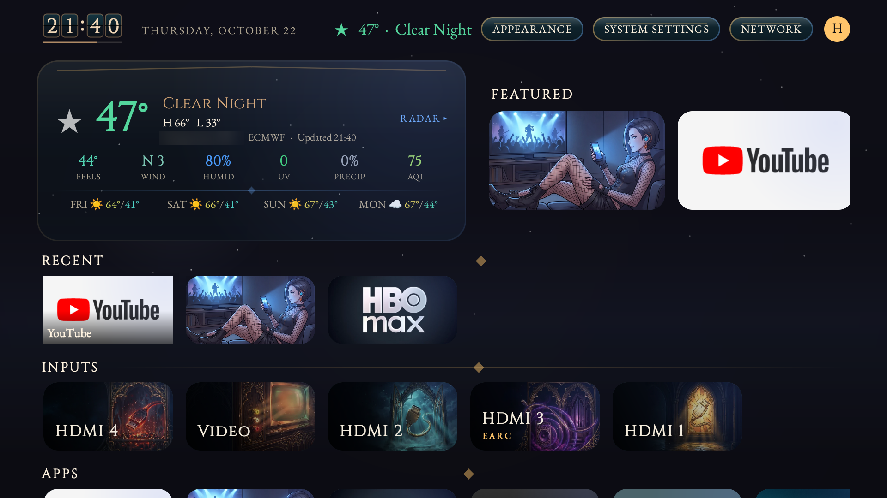
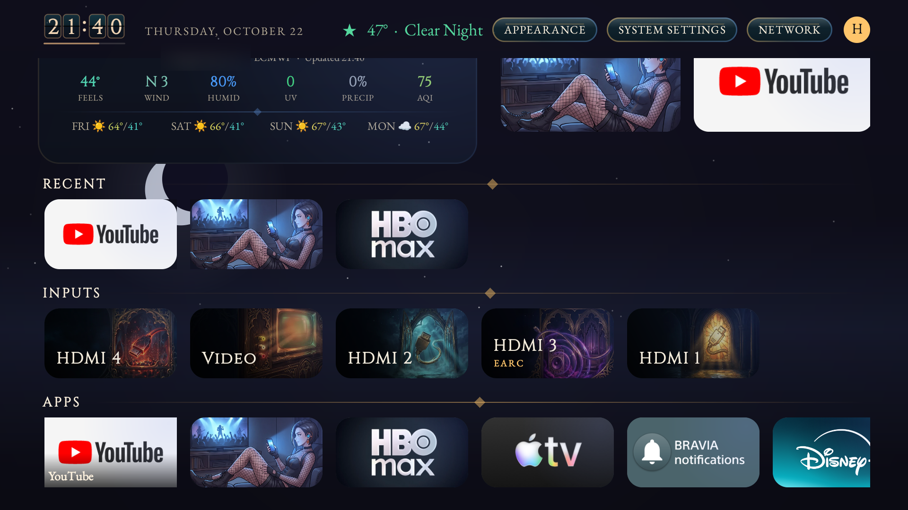
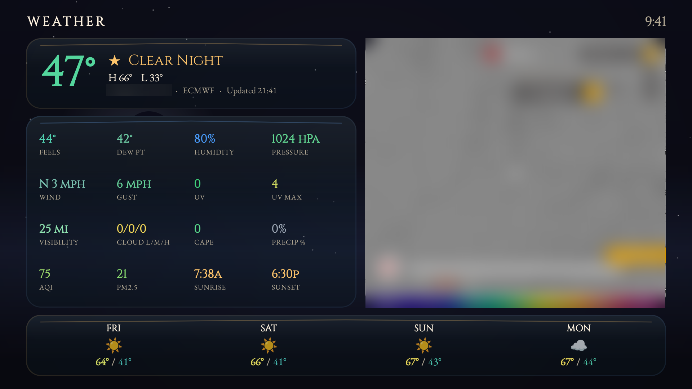
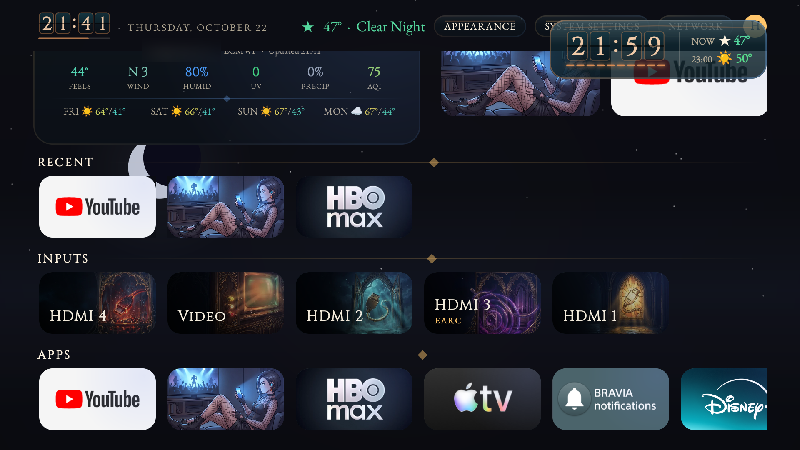
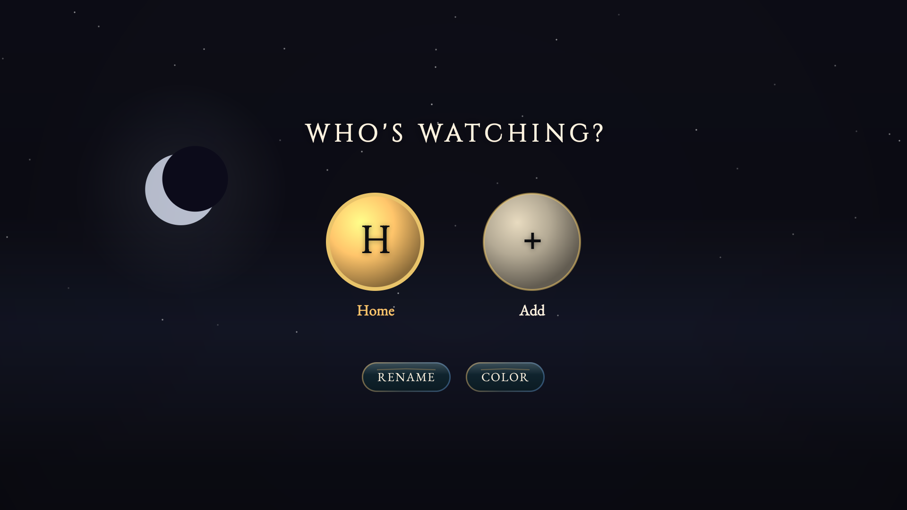
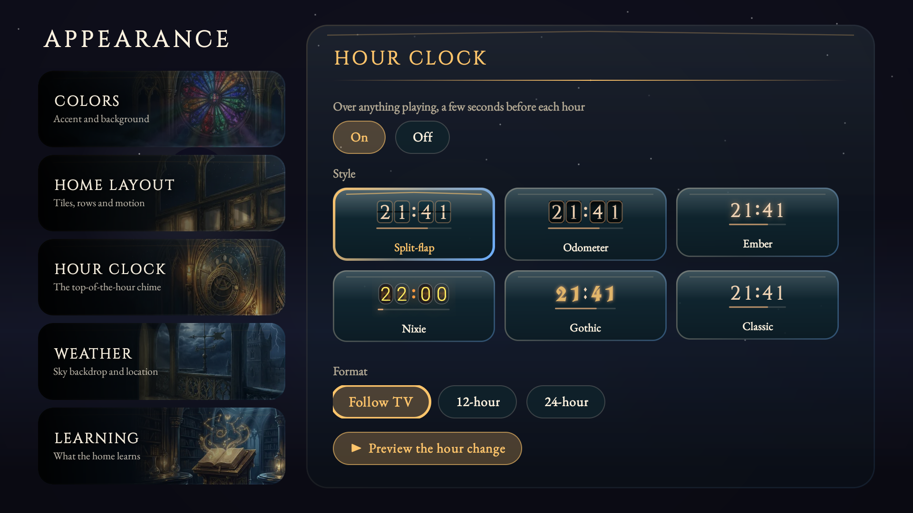
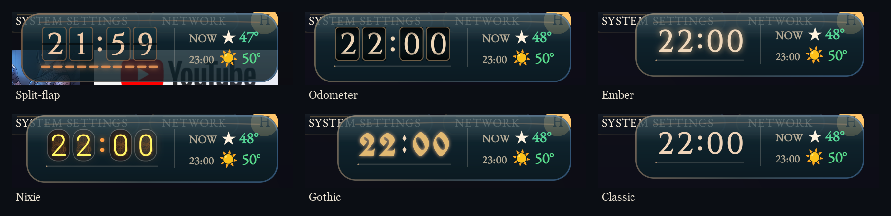

# Shart TV

An ad-free home screen for a Sony BRAVIA Google TV, plus a one-command tool that installs it and
switches off the stock launcher's ads, Samba TV's screen fingerprinting, and Sony's telemetry.

It keeps what the Google TV home gets right (apps up front, inputs one click away, a clock that
pops over whatever's playing at the top of the hour) and drops the sponsored rows. The weather is
built in: live conditions, a 16-metric dashboard, radar, and a forecast. The whole UI shifts color
over the 24 hours with the real sun.

Built for one TV, a Sony BRAVIA 4K VH21 (`BRAVIA_VH21_UC`, Android 12 / Google TV, SDK 31), on a
locked bootloader. No root, nothing exploited: everything goes through adb on the owner's own set.

Owner: sworrl <agent.jearl@gmail.com>

## Screenshots

Taken on the TV. The place name and the radar map are blurred.

| | |
|---|---|
|  |  |
| **Home.** Weather hero beside the Featured strip (pinned and most-used apps), the top bar with the hour clock and the profile avatar, then Recent. | **Rows.** Recent (the app you just left comes first), the inputs with their own art, then every app. |
|  |  |
| **Weather.** Current conditions, 16 metrics colored by value, live radar (blurred here), forecast, and the last-updated time. | **Hour chime.** At the top of every hour a glass card rolls the clock over (17:59 → 18:00) above whatever is playing, with the weather now and for the next hour. Playback and audio aren't touched. |
|  |  |
| **Who's watching?** Household profiles, each with its own theme, recents and learned apps. | **Appearance.** Section cards with their own art down the left, and the controls on the right. Each clock style card is a live clock. |

The hour clock comes in six animated styles: Split-flap, Odometer, Ember, Nixie, Gothic and
Classic. Each one tints with the time of day.



## Quick start

You need Python 3 and Android platform-tools (`adb`). To build from source you also need JDK 17
and Gradle 8 (see [Building](#building)).

```sh
scripts/sharttv.py
```

That's the whole setup, and it's safe to run as often as you like. Each step checks the TV first
and only changes what isn't already right:

1. **Find the TV.** It tries the last address it used, adb's mDNS, then a sweep of your LAN for
   adb on port 5555. A Sony that answers SSDP but has adb off still shows up, and the tool walks
   you through turning adb on.
2. **Turn on network adb** (first time only). It prints the steps, waits for the port to open,
   then waits for you to accept the "Allow USB debugging?" prompt on the TV. Firmware that only
   has Wireless debugging is handled with a pairing code.
3. **Build** the launcher if the sources are newer than the APK.
4. **Install** it, only if the TV's copy differs (it compares SHA-256 hashes).
5. **Configure:** turn on Location (Wi-Fi-based, for the weather), grant permissions, set Shart TV
   as the default launcher, and arm the HOME-redirect service.
6. **Debloat:** disable Samba TV ACR, the stock launcher's ad and content feeds, telemetry, the
   voice stack, and the camera-sensing stack, then cut the stock launcher's background data and
   background execution.

Other commands:

```sh
scripts/sharttv.py status      # what's set and what isn't; changes nothing
scripts/sharttv.py --dry-run   # what a deploy would change
scripts/sharttv.py discover    # just find the TV
scripts/sharttv.py guide       # the steps to turn on network adb
scripts/sharttv.py rollback    # re-enable everything it disabled
scripts/sharttv.py --tv 192.168.1.50 --groups samba,launcher   # skip discovery, pick groups
```

The tool writes nothing about your TV or network into the repo. It keeps the last-found address
and the list of what it changed in `~/.config/sharttv/state.json`.

### Turning on network adb by hand

1. Settings > System > About. Highlight **Android TV OS build** and press OK 7 times.
2. Settings > System > Developer options: turn on **USB debugging**, and **Network debugging**
   if your firmware shows it.
3. Run `scripts/sharttv.py` and accept the prompt on the TV, ticking "Always allow".

## What gets disabled

Everything is `pm disable-user`: nothing is uninstalled, and `rollback` puts it all back.

| Group | Packages | Why |
|---|---|---|
| `samba` | `tv.samba.ssm`, `tv.samba.ssm.ui` | Samba TV ACR fingerprints whatever is on screen and reports it. It rotates domains and hardcoded IPs, so DNS blocking doesn't stop it. Disabling it does. |
| `launcher` | `com.sony.dtv.sonytab`, `com.netflix.partner.ncm`, `com.sony.dtv.promos`, `com.sony.dtv.sonyselect`, `com.sony.dtv.launcherxcustomizer` | The stock launcher's sponsored rows, Sony tab, and partner feeds |
| `telemetry` | `com.sonyericsson.idd.agent`, `com.sony.dtv.demosupport`, `com.google.android.feedback` | Usage reporting and store-demo mode |
| `voice` | `com.sony.dtv.voicesearch`, `…voicerecognitionconfirmation`, `…assistantadapter` | Sony's voice stack (the mic is in the remote) |
| `sensing` | five `com.sony.dtv.sensingcamera*` / gesture / distance packages | BRAVIA CAM sensing; no camera is attached |
| `dlna` (optional) | `com.sonyericsson.dlna`, `com.sony.huey.dlna.*` | DLNA renderer. Chromecast is separate and keeps working. |

### Why the stock launcher stays installed

On this locked build Sony routes the HOME button to `launcherx` no matter what the default
launcher is set to. If you disable launcherx, HOME falls through to Sony's setup-recovery screen,
which is worse. So Shart TV leaves it enabled and works around it:

- **HOME redirect.** An accessibility service (`HomeRedirectService`) sees launcherx come up and
  brings Shart TV to the front. You'll see one frame of the stock launcher. Without root that
  flicker can't be avoided.
- **No background activity.** The tool denies launcherx background network and background
  execution, so its ad and recommendation feeds can't refresh. Android keeps whichever app owns
  HOME resident in memory: it's exempt from standby buckets and background kills, and adb's
  shell user isn't allowed to disable its components. So it stays loaded but idle.

The accessibility service only reads which app is in front, to drive the redirect, the Recent
row, and the hour chime. It ignores the contents of other apps.

## Features

- **Home.** One scrolling page. The weather hero sits beside a Featured strip of your pinned and
  most-used apps. Below come Recent (the app you were just in is focused when you come back),
  the inputs, and all apps. No ads, no sponsored rows, nothing from the stock launcher's feeds.
- **Bespoke art.** HDMI 1 to 4, composite video, and every Appearance section have their own
  painted card art in the home's gothic night style. Long input names like
  "HDMI 3 (eARC/ARC)" become a title plus a small caption, and labels shrink to fit their card.
- **Live sky.** Home, Weather, Appearance and Profiles all sit over the same animated sky. The
  sun and moon pass behind the glass cards, never over text.
- **Profiles.** Up to six household profiles from the avatar in the top-right corner. Each has its
  own theme, recents and learned usage. They live inside the launcher: switching real Android
  users needs system privileges this build doesn't give apps.
- **Weather.** Open-Meteo, keyless. The current conditions are overridden with **ECMWF IFS 0.25°**
  wherever that model has a value (it doesn't report visibility or UV, so those stay on Open-Meteo's
  best-match). It refreshes every 10 minutes while the screen is on, even when another app is in
  front, and the screen shows when it last updated.
- **Location.** In order: a [BeaconFix](https://github.com/sworrl/beaconfix) server on the LAN (a
  configured URL or `_beaconfix._tcp` over mDNS), a manual lat/lon, the TV's own Wi-Fi network
  location, the last cached fix, and an optional fallback from `app/location.properties`.
- **Hour chime.** A few seconds before each hour, a glass card shows the rollover and the weather
  for now and the next hour. It's an accessibility overlay: it can't be focused or touched, and
  it leaves playback and audio alone. It turns off in Appearance.
- **24-hour color.** The accent color follows the real sun (dawn, day, golden hour, dusk, night)
  and never repeats from one second to the next.
- **Hardening.** R8 full-mode minify and resource shrinking, release-signed, no backups. TLS
  trusts system CAs only, never user-installed ones.

## Building

```sh
cd app
gradle :launcher:assembleRelease
# -> app/launcher/build/outputs/apk/release/launcher-release.apk
```

You need JDK 17 and Gradle 8.9. The Gradle root is `app/`, not the repo root. All of these files
are gitignored and stay on your machine:

- `app/keystore.properties` (required for an installable release build):
  ```properties
  storeFile=sharttv-release.jks
  storePassword=...
  keyAlias=sharttv
  keyPassword=...
  ```
  Create the keystore with
  `keytool -genkeypair -keystore app/sharttv-release.jks -alias sharttv -keyalg RSA -validity 10000`.
- `app/location.properties` (optional): a fallback location for before the TV has a fix:
  `SEED_LAT=`, `SEED_LON=`, `SEED_PLACE=`.
- `app/windy.properties` (optional): Windy webcam and map keys.

The launcher is plain Java with no native code, so one APK runs on any ABI.

## Repository layout

| Path | What |
|---|---|
| `app/` | The launcher (Gradle project, package `com.sharttv.launcher`) |
| `scripts/sharttv.py` | Discover, enable adb, deploy, debloat, rollback |
| `docs/` | Launcher and remote specs, status, log, open questions |
| `docs/hardware/` | Board/SoC identification, unlock investigation, residual-privacy notes |
| `docs/screenshots/` | The images above |
| `SWEEP-REPORT.md` | Read-only device sweep and scored inventory of the stock components |

## Limits

- The bootloader is locked and there's no OEM-unlock option, so there's no root, custom kernel or
  system-level change. Everything here is an app or a setting applied over adb.
- The one-frame flash of the stock launcher on HOME stays (see above).
- Disabled packages survive reboots. The launcherx background-data restriction also persists.
  Run `scripts/sharttv.py` after any firmware update in case one re-enables something.
